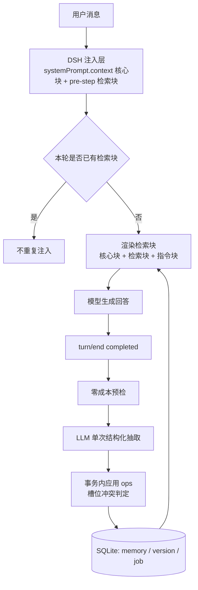

# AgentMemory 开题报告（草案）

> 用途：本科/硕士毕业设计开题申请底稿。方括号 `[...]` 处按学校模板替换。
> 配套技术设计见 [DESIGN.md](./DESIGN.md)。
> 说明：若你指的是金融湖仓那套系统，本文件不适用，需另出一版。
> 定位：本科毕设。以系统完整度、可演示性与效果可复现为准，不主张创新性。

---

## 1. 选题信息

**建议题目（推荐第一个）**

| 序 | 题目 | 适用场景 | 说明 |
|---|---|---|---|
| ★ | **支持动态更新的 AI Agent 跨会话记忆系统设计与实现** | 系统实现导向，本科首选 | "动态更新"直接对应增量（槽位替换 + 版本链 + 人工确认），与现有插件形成区分 |
| 2 | 基于 DeepSeek Harness 的跨会话长期记忆插件设计与实现 | 学院要求写明技术载体 | 载体明确，但容易被当成"插件开发"而非系统设计 |
| 3 | 面向 AI Agent 的长期记忆存储、更新与检索系统设计与实现 | 需要覆盖三项研究内容 | 三个动词对应三块工作，缺点是偏长 |
| 4 | 面向对话式智能体的记忆冲突消解与按需检索技术研究 | 偏研究型 / 硕士 | 本科做的是系统，题目与研究型表述易错位 |

**英文题目**：Design and Implementation of a Cross-Session Memory System with Dynamic Update for AI Agents

**申报系统用题目（表单禁止不常见缩写）**：《支持动态更新的智能体跨会话记忆系统设计与实现》
外文：Design and Implementation of a Cross-Session Memory System with Dynamic Update for Intelligent Agents

**申报表其余字段建议**：课题来源=学生自拟（或导师在研项目）；课题性质=软件开发（次选工程设计/应用研究）；论文类型=毕业设计；研究方向=智能体长期记忆;信息检索（网安方向可改"隐私保护;本地存储"）；是否社会实践=否（无佐证材料时）。

**命名提醒**：`AgentMemory` 作为系统代号写在摘要与系统章节，不进主标题——主标题要能看出"做了什么、解决什么"，不能只有一个英文名。避免"基于大模型的……"（太泛）、"类 ChatGPT 记忆……"（暗示复刻）。

**"模块"式题目慎用**：如《面向 AI Agent 的跨会话长期记忆与智能管理模块》，弱在三点——"模块"易被当成他人系统的部件、缺少"设计与实现"、正文无法对应"智能管理"章节。若导师要求此句式，最小可行版为《面向 AI Agent 的跨会话长期记忆管理模块的设计与实现》，并在正文首段声明其为可独立部署的子系统（含存储、更新、检索三层）。

**候选题定稿（25 字，卡多数学校上限）**：《面向大语言模型智能体的跨会话长期记忆系统设计与实现》
- 外文：Design and Implementation of a Cross-Session Long-Term Memory System for Large Language Model Agents
- 替换说明：`Agent`→"智能体"（表单禁外文/缩写）；**"管理系统"不可用**——中文语境默认指 CRUD 后台，会低估技术含量，管理面板作为功能写进正文即可。
- 超长时按序砍：去"大语言模型"（21 字）→ 去"长期"（23 字，不建议）→ "跨会话"不可砍。
- 若学校允许 30 字，优先用 29 字版保留增量：《支持动态更新的面向大语言模型智能体的跨会话记忆系统设计与实现》——用"长期"换"动态更新"，区分度更高。

**注意题目与内容一致**：若题目含"动态更新"，正文必须有槽位替换、版本链、人工确认三节；若题目未含，这三节仍要写，但在摘要第一段点明"本文重点解决记忆的动态更新问题"，否则会被当成又一个通用记忆插件。

**一句话定位**

构建一个运行在 DeepSeek Harness（DSH）插件层的长期记忆系统，解决现有对话智能体"跨会话失忆"与"记忆过期失真"两个问题，并通过可追溯的版本化存储与可量化的评测验证其有效性。

**学科定位**：属于 Agent 长期记忆（long-term memory）方向，检索是其支撑技术与对外出口，但不是全部；与 RAG 的区别在于处理的是会变化的用户信息，核心是更新、失效与回滚。

### 1.1 给导师的介绍（可直接用）

**30 秒版**

> 老师，我做的是 AI 编程助手的跨会话长期记忆系统。现在这类工具新开一个会话就把之前的背景忘了，用户得反复自我介绍。我的系统从对话里把值得长期保留的信息存进本地数据库，新会话自动带进去；重点是把"记忆更新"做对——比如原来打算走 Java 后端，后来改成大数据平台，系统会把旧的那条标记为已失效，而不是两条并列，并且每次修改都可回滚、用户手写的记忆后台不能改。最后用一套标注数据和现有几个开源插件做对比评测。

**1 分钟版（在 30 秒版后补三句）**

1. 技术：DSH 插件层接入，SQLite + FTS5 全文检索，不依赖外部服务，装上即用。
2. 难点：不是"存下来"，是"存对了"——新旧冲突怎么判定、注入多少不浪费 token、后台整理出错怎么退回。
3. 验证：自建中文标注集 + 五个可演示场景 + 与两个现有开源插件的对比实验。

**书面版（微信/邮件）**

> 老师好，我拟定的题目是《支持动态更新的 AI Agent 跨会话记忆系统设计与实现》。系统以 DSH 插件形式接入，解决对话 Agent 跨会话丢失用户背景、以及记忆随时间过期失真的问题；采用 SQLite + FTS5 做本地存储与检索，重点实现记忆的槽位化冲突消解、版本回滚与注入预算控制，并用自建标注集和开源实现做对比评测。想请您看看选题方向是否合适。

**与 RAG 的区别（被问就答）**

| 维度 | RAG | 本系统 |
|---|---|---|
| 数据 | 静态文档，只增不改 | 对话产生的用户事实，会过期、会冲突 |
| 写路径 | 无 | 有，需判新旧关系、可回滚 |
| 指标 | 召回率、精确率 | 另加过期记忆误用率、冲突误判率 |

**措辞提醒**：不要自称"类 ChatGPT 的记忆"，容易被理解为复刻产品；说"面向编程 Agent 的跨会话记忆，重点是记忆更新"。

**研究问题（开题必须写清楚，不要写成功能清单）**

1. 如何从开放域对话中稳定抽取"值得长期保存"的用户信息，并抑制误抽取？
2. 用户信息随时间变化产生冲突时，如何在存储层判定新旧关系，而不是依赖模型自觉？
3. 在有限上下文预算下，如何决定"注入什么、注入多少"，兼顾召回率与推理成本？
4. 后台自动整理引入的错误如何被审计、回滚与人工纠正？

---

## 2. 技术栈

### 2.1 实现栈

| 层 | 选型 | 理由 | 风险 |
|---|---|---|---|
| 语言/运行时 | TypeScript + Node.js `^22.19` | DSH 插件生态的硬约束；`node:sqlite` 在该版本可用 | 无 |
| 插件框架 | DSH（Cordis 容器）插件 API | 提供 `systemPrompt.context` 注入、`agent/pre-step` 尾部追加、工具注册、`session/event` 生命周期、`sessionPersistence` 历史会话读取 | 框架仍在快速迭代，需锁定版本区间 |
| 存储 | SQLite（内置 `node:sqlite`，WAL 模式） | 零原生依赖、零构建，可直接从 npm/git 安装；单文件可备份 | API 仍标记 experimental，需隔离在单一模块内 |
| 全文检索 | SQLite FTS5 + `bm25()` + **字符二元组影子列** | 无需外部检索引擎；实测 `trigram` 对「湖仓」这类双字词命中为 0，故用 bigram 展开后建 `unicode61` 索引 | bigram 需在写入与查询两侧做同一套展开，预处理逻辑要单测 |
| 结构化数据 | `STRICT` 表 + CHECK 约束 + 部分唯一索引 | 冲突规则下沉到数据库，应用层无法绕过 | 迁移需版本化脚本 |
| 智能抽取 | DSH 当前配置的 LLM（`ctx.llm.stream`） | 复用宿主模型与鉴权，不额外引入 API Key | 输出不稳定，需宽松解析 + 校验 |
| 后台任务 | `turn/end` 事件 + 进程内队列 | 无需消息队列中间件；失败不影响聊天 | 进程重启需靠水位线补偿 |
| 前端/管理 | 插件工具 + Markdown/JSON 导出（V1） | 避免为一张设置页引入 client 半与前端构建 | 后续可选只读评审页 |
| 测试 | `node:test` + 快照测试 + 假 LLM 适配器 | 与宿主同栈，无额外测试框架 | 无 |
| 打包 | pnpm + ESM，无构建步骤 | 用户安装无需授予构建脚本权限 | 无 |

**明确不引入**：Kafka、Flink、Spark、Redis、独立 PostgreSQL、向量数据库。理由：单机单用户量级（10³–10⁴ 条记忆），引入分布式组件只会增加部署成本，不提升任何指标。这一点要在开题里写出来，答辩时是加分项而不是减分项。

### 2.2 研究栈（论文方法部分）

| 方向 | 用到的方法/概念 |
|---|---|
| 信息检索 | BM25 排序、倒排索引、查询构造与转义、召回率/精确率、RRF 融合 |
| 数据管理 | 事件溯源、版本链、软删除与墓碑、乐观并发控制、事务隔离 |
| 认知架构 | 工作记忆/情景记忆/语义记忆/程序性记忆的分类（CoALA） |
| 提示工程 | 结构化 JSON 抽取、上下文预算分配、注入内容与指令的边界隔离 |
| 实验方法 | 金标注集构建、消融实验、显著性检验、成本-效果权衡分析 |

---

## 3. 开题报告逐节写法

### 3.1 选题背景与意义（约 600 字）

写作要点，按"现象 → 原因 → 代价 → 本文切入点"四段推进：

1. **现象**：对话式智能体在单会话内表现良好，但新开会话即丢失用户背景，用户被迫重复自我介绍。
2. **原因**：主流做法是把上下文当作"一次性窗口"，会话结束即丢弃；产品侧的"保存记忆"依赖用户显式指令，覆盖面窄。
3. **代价**：重复沟通成本；长周期任务（毕业设计、长期项目）无法延续；偏好与约束被遗忘导致输出不一致。
4. **切入点**：把记忆当作一类需要**持续维护的数据**，而不是聊天记录的检索副本。因此引入抽取、冲突消解、版本化、按需检索与生命周期管理。

意义分两层写：工程意义（可复用的 Agent 记忆插件，服务真实开发场景）；研究意义（记忆冲突消解与上下文预算分配是可量化的数据管理/检索问题）。

### 3.2 国内外研究现状（约 1200 字，三条线）

**（1）认知架构与记忆分类**
CoALA 把语言智能体的记忆分为工作记忆、情景记忆、语义记忆、程序性记忆，为记忆分类提供理论依据。Generative Agents 用"记忆流 + 反思 + 检索"证明长期记忆能显著改善智能体行为一致性。这两条线支撑本文的 `kind` 分类设计。

**（2）长期记忆的系统实现**
MemGPT 提出把上下文窗口当作"内存"、把外部存储当作"磁盘"的分层管理思路；MemoryBank 引入遗忘曲线式的记忆强度衰减；A-MEM 探索记忆之间的关联网络。它们的共同局限是：以"追加 + 向量检索"为主，对**同一事实随时间变化**的处理较弱。

**（3）评测基准**
LongMemEval 针对长期交互记忆提出多类型测评（信息抽取、多会话推理、时间推理、知识更新、 abstention）。其中"知识更新"与"时间推理"子项，正是本文冲突消解模块要对齐的能力。

**（4）产品与工程实践**
ChatGPT 的记忆经历了"保存记忆（2024）→ 后台 dreaming 整理（2025）→ Dreaming V3（2026）"的演进，官方明确把"保持时效性（stay current over time）"列为三大目标之一，并提供可审阅的记忆摘要页。Claude Code 采用 `MEMORY.md` + 按需读取专题文件的两层结构。开源侧，DSH 生态已出现 Markdown 记忆插件，以及基于 SQLite + BM25 的记忆实现。**说明**：产品均未公开内部实现，本文只借鉴其公开行为与设计目标，不声称复刻。

**（5）研究空白（本文的落点）**
现有工作多聚焦"记得更多"，较少讨论"记错怎么办"。具体缺口：
- 冲突判定依赖模型自觉，缺少存储层硬规则；
- 缺少可回滚的版本链与人工确认通道；
- 注入策略多为"全量"或"纯检索"两端，缺少预算约束下的分层方案；
- 缺少面向插件形态的工程化评测。

### 3.3 研究内容（四个，不要写成五个功能）

1. **面向长期记忆的槽位化数据模型**：`scope × kind` 两维分类 + `topic_key` 槽位 + 版本链，使"职业方向变化""技术栈更替"可被确定性判定为替代关系而非并列事实。
2. **基于全文检索与结构化过滤的按需召回**：FTS5 + BM25 + 时间衰减 + 重要度重排；中文场景下的分词方案对比（`unicode61` / `trigram` / **字符二元组 bigram 影子列**）。已实测 `trigram` 对双字中文查询命中为 0，故 bigram 是主路径而非备选。
3. **预算约束下的分层注入策略**：稳定核心块 + 动态检索块 + 固定指令块，研究预算分配对召回率、token 开销与 KV cache 命中率的影响。
4. **带人工保护的后台整理机制（Dreaming）**：触发条件、双阶段（零成本预检 + 单次 LLM 调用）、静默执行者的权限降级、冲突变更落"提案"待用户确认。

### 3.4 技术路线

数据库设计要点写进开题（评委爱看这个）：`memory`（当前态）、`memory_version`（审计链）、`project`（作用域）、`session_cursor`（增量水位）、`dream_job`（成本与失败审计）、`dream_proposal`（人工确认）、`memory_fts`（bigram 全文索引）。给出 1–2 张核心表字段即可，不必贴全量 DDL。

### 3.5 系统特色（本科口径：写"特色"，不写"创新"）

本科开题不必主张发明新方法，写"系统在哪些点上做得比现成方案扎实"即可：

1. **冲突处理是规则，不是提示词**：新旧信息落在同一 `topic_key` 上时，由数据库唯一索引 + 事务保证"只能有一条活跃值"，旧值自动转 `superseded` 并保留版本。演示时可以直接看到"职业方向"被替换而不是并存两条。这条规则已在本机 SQLite 上跑通（唯一索引拒绝第二条活跃值）。
2. **每条记忆都可追溯**：任何写入同事务记入版本链，支持查看历史、回滚、软删除。答辩现场可以演示"改错了怎么退回去"。
3. **注入有预算、有去重**：稳定内容与检索内容分层，整轮只注入一次，缓存友好；compaction 之后能自动补投。可对比"全量注入"的 token 开销。
4. **人工优先**：用户手动写的记忆，后台整理无权删改，只能生成待确认提案。
5. **用户可查看、可修改**：V1 通过记忆工具与 Markdown/JSON 导出提供查看、搜索、编辑、删除、历史查看；管理面板放到 V1.5 再评估（参照插件为一个设置页写了 3210 行客户端，V1 不承担这个成本）。手动修改后的条目自动升为受保护状态，修改本身也写版本链，所以"改错了"同样能退回。

措辞建议：用"实现了""保证了""可验证"，不用"提出了全新的""填补了空白"。评委对本科的期待是"做完整、做对、能演示"，不是"有理论突破"。

**答辩口径**：如果被问"你的创新点是什么"，回答"本科阶段不追求方法创新，重点是把长期记忆的工程问题做完整：冲突可判定、变更可回滚、效果可量化"，然后直接演示。

### 3.6 可借鉴的技术路线与开源实现

> 结论：技术风险已被生态摊平，**不要重复造轮子**；难度体现在"复现 + 增量 + 对比"，不是"从零手写"。

| 借鉴对象 | 可复用的具体机制 | 落到本项目的哪一层 | 我们的差异 |
|---|---|---|---|
| dsh-plugin-memory 0.20.0（MIT） | 注入走 `systemPrompt.context` 快照（宿主负责 supersede）、稳定块与易变块拆 order、会话级冻结开关、按字符的预算分配（index 优先）、`/memory on|off` 命令、git 自动提交 | 注入层 / 配置层 / 交互层 | 写入改为工具 + SQLite（可控可测），注入拆"核心块 + 检索块"，而非全量转储 |
| dsh-memory-graph（MIT） | `STRICT` 表 + `CHECK`；FTS5 外部内容表 + `tokenize='trigram'`；`stable_key` 部分唯一索引做"同槽位仅一条活跃"；`memory_revert`；turn archive；写失败 outbox；CJK token 估算；40 个 vitest | 存储层 / 检索层 / 可靠性 | 增加跨会话（`sessionPersistence`）增量整理与人工确认提案 |
| dsh-meow-memory（MIT） | 七层记忆分类（soul/user/project/fact/lesson/topic/rules）；中文 BM25（`NFKC` + CJK bigram + 停用词 + 单字过滤）；艾宾浩斯式时间衰减；分窗 dream；Web 面板 | 分类模型 / 排序 / UI | 分类收敛为 `scope × kind`，冲突用槽位规则而非纯打分 |
| OpenViking dsh-memory-plugin（Apache-2.0） | 三级内容模型（abstract / overview / full）、渐进披露、工具结果捕获开关 | 注入预算 / 工具设计 | 不引入外部 server 依赖 |
| ChatGPT Dreaming（公开产品行为） | 三大目标（延续上下文 / 遵循偏好 / 保持时效）、后台合成、**可审阅的记忆摘要页** | 评测目标 / 评审界面 | 只借鉴公开行为，不声称复刻内部实现 |
| LongMemEval | 五类题型：信息抽取、多会话推理、时间推理、知识更新、abstention | 评测协议 | 补充中文标注集 |

**借鉴边界（答辩必须能一句话说清）**

1. **代码层**：不复制粘贴。参考实现用来验证设计可行性、以及当 baseline；论文与仓库 README 中列明参考项目与许可证。
2. **设计层**：公开设计可以借鉴，自己的增量必须能一句话说完。本文的增量是：跨会话增量整理 + 冲突变更走人工确认提案 + 评审页。
3. **评测层**：把参考实现装成 baseline，跑同一套题。这是加分项，不是减分项。

**三种毕设做法，按风险排**

| 模式 | 做法 | 贡献如何表述 | 风险 |
|---|---|---|---|
| A（推荐） | 独立实现，设计借鉴，参考实现只作 baseline | "完整实现了……并在……上优于/持平基线" | 工作量最大，但答辩最稳、查重最干净 |
| B | fork 一个插件做二次开发，列清改动清单 | "在 X 基础上增加了……" | 需遵守 MIT/Apache 许可；评委可能追问哪些是自己写的 |
| C | 不做插件，做"记忆中间层 + 统一评测" | "提出评测协议并对比 N 个实现" | 系统实现篇幅偏少，本科容易被质疑"没做系统" |

建议 A。若时间紧，A 的前半段可以用参考实现的 schema 与提示词设计快速定型，把精力留给增量与评测。

### 3.7 实验与验收（本科：效果优先）

先定"能演示什么"，再定"测什么"。五个演示场景，每个都要有可截图的结果：

| # | 演示场景 | 期望结果（验收线） |
|---|---|---|
| 1 | 会话 A 告知背景（计算机专业、熟悉 Java、做金融湖仓），新开会话 B 问"我该补哪些技术" | B 不追问背景，回答中引用 A 的信息 |
| 2 | 会话 A 说"打算走 Java 后端"，几天后说"改主攻大数据平台" | 记忆库里只有一条活跃职业方向；旧值标记为已替代，历史可查 |
| 3 | 问"我的毕设到哪一步了" | 只召回项目进度相关记忆，不把个人背景全量塞入 |
| 4 | 手动写入一条记忆后触发后台整理 | 后台不修改该条；若想改，只生成待确认提案 |
| 5 | 同一会话连续 10 轮对话 | 记忆提醒只注入 1 次，不重复占上下文 |
| 6 | 打开记忆面板，改一条、删一条、看一条历史 | 修改立即生效并带"手动"标记；后台整理不再改写它；历史里能看到改前改后 |

评测实验（支撑论文数据）：

| 实验 | 设计 | 指标 |
|---|---|---|
| 抽取质量 | 自建 50–100 段标注对话（中英混合），人工标注"应入库事实" | 精确率、召回率、误抽取率 |
| 冲突消解 | 构造 30 组"旧值 → 新值"用例（职业方向、技术栈、项目状态） | 正确替代率、误合并率、过期误用率 |
| 检索效果 | 100 条查询，标注相关记忆 | Recall@5、MRR、p95 延迟 |
| 注入策略消融 | 全量注入 / 纯检索 / 分层注入（本文） | 回答正确率、注入 token、KV cache 命中率 |
| 端到端 | LongMemEval 子集（知识更新、时间推理、多会话） | 各子项得分、每题 token 成本 |
| 对照系统 | 纯 Markdown 记忆插件 / SQLite+FTS5 / 本文系统 | 同上 |

### 3.8 进度安排（按周次，按学校周历改）

| 阶段 | 周次 | 内容 | 交付物 |
|---|---|---|---|
| 调研 | 1–3 | 框架 API 验证、参照插件源码分析、相关工作报告 | 调研报告、API 验证记录 |
| 设计 | 4–5 | 数据模型、注入与检索方案、评测方案 | 详细设计文档、DDL |
| 实现一 | 6–9 | 存储层、版本链、检索、注入、工具 | 可运行 V1.0 |
| 实现二 | 10–13 | 抽取、后台整理、冲突消解、人工确认、记忆管理面板 | V1.5 |
| 评测 | 14–16 | 金标注集、消融实验、对照实验 | 实验数据与图表 |
| 撰写 | 17–18 | 论文撰写、查重、修改 | 论文终稿 |
| 答辩 | 19 | 演示系统与答辩材料 | 演示脚本、PPT |

### 3.9 预期成果

1. 可安装的 DSH 记忆插件（开源，MIT），支持全局/项目两级记忆与版本追溯。
2. 一套中文长期记忆评测集与评测脚本。
3. 毕业论文一篇，含 5 类实验与消融结果。
4. 技术文档：架构说明、数据库设计、API 说明。

### 3.10 可行性分析

| 维度 | 判断 |
|---|---|
| 技术 | 四个关键接口已在 DSH 源码与本机环境验证通过；SQLite FTS5 中文方案已实测 |
| 数据 | 无需真实用户数据，评测集可自行构造；LongMemEval 公开可用 |
| 工作量 | 核心代码量可控（存储/检索/注入约 2–3k 行），难点在评测而非编码 |
| 风险 | DSH 版本变动 → 用插件契约隔离，核心层可脱离宿主单测；LLM 输出不稳定 → 宽松解析 + 事务回滚 + 不重试策略 |

---

## 4. 答辩可能被问的 6 个问题

| 问题 | 回答要点 |
|---|---|
| 和 RAG 有什么区别？ | RAG 检索的是静态文档，记忆要处理"同一事实随时间的多个版本"和"用户本人信息"，核心是更新与失效，不是召回。 |
| 和现有 Markdown 记忆插件比，价值在哪？ | 三条：槽位冲突消解是规则不是提示；版本链可回滚；有量化评测。 |
| 为什么不直接用向量库？ | 单机万级数据 BM25 足够；引入向量库/嵌入模型会带来原生依赖与部署成本，V2 再按评测结果决定。 |
| 记忆抽错了怎么办？ | 三道闸：写入前敏感信息筛查、应用前乐观并发校验、输出后版本链可回滚；后台无权改人工条目，冲突走提案。 |
| Dreaming 会不会烧钱？ | 默认关闭 + 三重闸门（字符阈值、轮次冷却、每日 token 预算），单次单调用，失败不重试。 |
| 创新点够不够？ | "本科阶段不追求方法创新。我的目标是做完整、做对、能复现：冲突可判定、变更可回滚、效果有数据。" 随后演示场景 2 与场景 4。 |

---

## 5. 参考文献（按学校格式补全卷期页码）

1. Sumers T, Yao S, Narasimhan K, Griffiths T. Cognitive Architectures for Language Agents. arXiv:2309.02427, 2023.
2. Packer C, Wooders S, Lin K, et al. MemGPT: Towards LLMs as Operating Systems. arXiv:2310.08560, 2023.
3. Park J S, O'Brien J, Cai C, et al. Generative Agents: Interactive Simulacra of Human Behavior. UIST, 2023.
4. Wu D, Wang H, Yu W, et al. LongMemEval: Benchmarking Chat Assistants on Long-Term Interactive Memory. ICLR, 2025. arXiv:2410.10813.
5. Zhong W, Guo L, Gao Q, et al. MemoryBank: Enhancing Large Language Models with Long-Term Memory. AAAI, 2024.
6. Lewis P, Perez E, Piktus A, et al. Retrieval-Augmented Generation for Knowledge-Intensive NLP Tasks. NeurIPS, 2020.
7. Robertson S, Zaragoza H. The Probabilistic Relevance Framework: BM25 and Beyond. Foundations and Trends in Information Retrieval, 2009.
8. Liu N F, Lin K, Hewitt J, et al. Lost in the Middle: How Language Models Use Long Contexts. TACL, 2024.
9. OpenAI. Dreaming: Better memory for a more helpful ChatGPT. 2026-06-04.
10. SQLite. FTS5 Extension Documentation.
11. DeepSeek AI. DeepSeek Harness (DSH) 插件开发文档.

> 参考文献请在提交前逐条核对年份、卷期与页码；不确定的条目宁可删掉，不要留错引。

---

## 6. 需要你替换/补充的内容

- [ ] 学校开题模板的固定章节名与字数要求
- [ ] 研究现状中本校/国内相关工作的引用（评委更看重）
- [ ] 周次表对齐学院教学日历
- [ ] 若为硕士开题：把"创新点"扩为"拟解决的关键科学问题"，并补充理论分析章节（如冲突消解的判定规则完备性）
- [ ] 本科开题：删掉"创新点"小标题，改成"系统特色"；把 3.7 的五个演示场景提到技术路线之后，让评委先看到效果
- [ ] 本科开题：实验部分保留 LongMemEval 子集作为外部对照，自建中文标注集为主，二者不要互相替代
- [ ] 开题/论文中显式列出参考项目与许可证（dsh-plugin-memory、dsh-memory-graph、dsh-meow-memory），并说明借鉴边界
